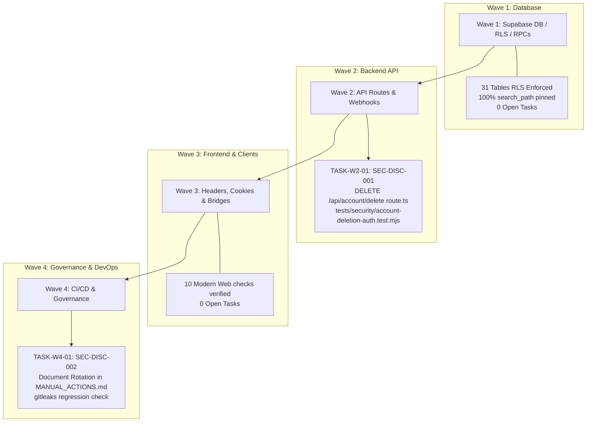

# Security Remediation Specification — Elephant Session

**Campaign:** Security Window Closure 2026-11-21  
**Target Branch:** `security/window-closure-20261121`  
**Architecture:** Google Mantis + Elephant-Goldfish Spec-Driven Workflow  
**Scope:** Appointments Monorepo (Next.js 15 App Router, Supabase PostgreSQL, CI/CD, Git Infrastructure)  
**Input Catalog:** [.gsd/SECURITY_OPEN_WINDOWS.json](file:///Users/trinadh/projects/Appointments/.gsd/SECURITY_OPEN_WINDOWS.json), [.gsd/COVERAGE_LEDGER.json](file:///Users/trinadh/projects/Appointments/.gsd/COVERAGE_LEDGER.json)  
**Stage:** Stage 2 (Elephant Remediation Spec & Wave Graph)  
**Governing Standard:** Autonomous, unattended execution governed by GLOBAL RULES R1 through R6.

---

## 1. Architectural Grouping by Root Cause & Layer

```
┌────────────────────────────────────────────────────────────────────────┐
│ Wave 1: Database Schema, Triggers, RLS & SQL Functions (database-arch)  │
│ - 31/31 public tables with RLS active; 3 views security_invoker        │
│ - 100% SECURITY DEFINER functions have search_path pinned               │
│ - Zero open finding windows in database layer for this campaign        │
└───────────────────────────────────┬────────────────────────────────────┘
                                    │
┌───────────────────────────────────▼────────────────────────────────────┐
│ Wave 2: Backend API Routes & Auth Synchronization (backend-specialist) │
│ - SEC-DISC-001: DELETE /api/account/delete auth context mismatch       │
│   (service_role lacks user auth.uid() context for RPC invocation)      │
└───────────────────────────────────┬────────────────────────────────────┘
                                    │
┌───────────────────────────────────▼────────────────────────────────────┐
│ Wave 3: Frontend Headers, CSP, Cookies & Bridges (frontend/mobile)     │
│ - All 10 Modern Web candidates reviewed safe / defense-in-depth        │
│ - Zero open finding windows requiring code changes in Wave 3           │
└───────────────────────────────────┬────────────────────────────────────┘
                                    │
┌───────────────────────────────────▼────────────────────────────────────┐
│ Wave 4: CI/CD, Scanning Rules & Infrastructure Governance (devops-eng) │
│ - SEC-DISC-002: Historical commit secret leaks in git log [NEEDS_HUMAN]│
│   (Documented rotation & git-filter-repo protocol in MANUAL_ACTIONS.md)│
└────────────────────────────────────────────────────────────────────────┘
```

---

## 2. Detailed Technical Specifications & Invariants per Finding

### Fix Packet 1: Backend API Account Deletion Auth Context Synchronization (`SEC-DISC-001`)

- **Finding Identifier:** `SEC-DISC-001` (CWE-285: Improper Authorization)
- **Target Source File:** `apps/merchant-web/src/app/api/account/delete/route.ts`
- **Target Test File:** `tests/security/account-deletion-auth.test.mjs`
- **Assigned Wave & Role:** Wave 2 (`backend-specialist`)
- **Task Identifier:** `TASK-W2-01`

#### A. Root Cause Analysis
In `apps/merchant-web/src/app/api/account/delete/route.ts` (lines 44–70), the HTTP `DELETE` handler validates the authenticated user session via `getRouteSupabaseClient(req)` and retrieves the authenticated caller object `user` via `supabase.auth.getUser()`. However, at line 56–61, the handler invokes the database stored procedure `delete_account_immediately`:
```typescript
const supabaseAdmin = getSupabaseAdmin();

// 1. Execute atomic data anonymization and PII erasure immediately
const { data, error } = await (supabaseAdmin.rpc as any)('delete_account_immediately', {
  p_reason: reason,
});
```
The underlying SQL function `public.delete_account_immediately(p_reason TEXT)` in `supabase/migrations/20261121000002_immediate_account_deletion_and_single_admin.sql` (lines 46–54) enforces an explicit authentication check:
```sql
DECLARE
    v_uid UUID := (SELECT auth.uid());
    v_req_id UUID;
    v_anonymize_res JSONB;
BEGIN
    IF v_uid IS NULL THEN
        RAISE EXCEPTION 'Not authenticated' USING ERRCODE = '42501';
    END IF;
    ...
```
When `supabaseAdmin` (the `service_role` client) invokes the RPC, the request carries the service key JWT without a user context. In Supabase/PostgREST, `auth.uid()` evaluates to `NULL` for `service_role` requests unless explicitly set via user impersonation. Consequently, the stored procedure raises an unhandled PostgreSQL exception `'Not authenticated'` (ERRCODE `42501`), causing `apps/merchant-web/src/app/api/account/delete/route.ts` to log an error and unconditionally respond with `HTTP 500 Internal Server Error`:
```json
{ "error": "Not authenticated" }
```
This defect was empirically confirmed on the baseline branch with a RED reproduction script (`.gsd/evidence/DISCOVERY_MANTIS/test_account_delete_failure.*`), aborting all legitimate self-service account deletion attempts.

#### B. Security & Regulatory Invariants
1. **DPDP Act 2023 §12 (Right to Erasure)**:
   - Data principals must be able to immediately and permanently delete their personal data without artificial roadblocks, delays, or unhandled 500 exceptions.
2. **Google Play Store Account Deletion Mandate (May 2024 Policy)**:
   - In-app account deletion must be fully functional for authenticated users, initiating immediate deletion with zero grace period.
3. **IDOR & Authorization Isolation**:
   - The deletion target MUST be bound exclusively to the authenticated session (`user.id` from `supabase.auth.getUser()` / `auth.uid()`). A caller must never be able to trigger deletion of another user's account by specifying an arbitrary user ID or identifier in the payload.
4. **Context Propagation**:
   - The route handler already constructs a user-scoped Supabase client `supabase` using `getRouteSupabaseClient(req)` that forwards the user's `Bearer` token or session cookies.
   - Invoking `supabase.rpc('delete_account_immediately', { p_reason: reason })` directly propagates the caller's JWT to PostgREST, enabling `(SELECT auth.uid())` in the SQL function to resolve to the authenticated user's UUID.
5. **Session Revocation & Cleanup**:
   - After atomic database anonymization and erasure via `supabase.rpc('delete_account_immediately')`, the administrative client `supabaseAdmin.auth.admin.deleteUser(user.id)` purges the auth user record from `auth.users`, invalidating all active refresh tokens, sessions, and credentials.

#### C. Code Invariants & Remediation Design
In `apps/merchant-web/src/app/api/account/delete/route.ts`:
```typescript
// Replace:
// const { data, error } = await (supabaseAdmin.rpc as any)('delete_account_immediately', {
//   p_reason: reason,
// });

// With user-scoped client invocation:
const { data, error } = await (supabase.rpc as any)('delete_account_immediately', {
  p_reason: reason,
});
```

**Full Proposed Handler Logic:**
```typescript
export async function DELETE(req: NextRequest) {
  try {
    const supabase = await getRouteSupabaseClient(req);
    const { data: { user }, error: authError } = await supabase.auth.getUser();

    if (authError || !user) {
      return NextResponse.json({ error: 'Unauthorized' }, { status: 401 });
    }

    const body = await req.json().catch(() => ({}));
    const reason = typeof body?.reason === 'string' ? body.reason.slice(0, 500) : 'User initiated immediate account deletion';

    // 1. Execute atomic data anonymization and PII erasure using user-scoped client
    const { data, error } = await (supabase.rpc as any)('delete_account_immediately', {
      p_reason: reason,
    });

    if (error) {
      console.error('[Account Delete] RPC error:', error);
      return NextResponse.json({ error: error.message }, { status: 500 });
    }

    // 2. Remove the auth user record to revoke active auth sessions/tokens
    const supabaseAdmin = getSupabaseAdmin();
    try {
      await supabaseAdmin.auth.admin.deleteUser(user.id);
    } catch (authDelErr) {
      console.warn('[Account Delete] Auth admin delete notice:', authDelErr);
    }

    return NextResponse.json({
      success: true,
      immediate: true,
      message: 'Your account and all personal data have been immediately and permanently deleted.',
      completed_at: new Date().toISOString(),
    }, { status: 200 });
  } catch (err) {
    const msg = err instanceof Error ? err.message : 'Internal error';
    console.error('[Account Delete] Exception:', err);
    return NextResponse.json({ error: msg }, { status: 500 });
  }
}
```

#### D. Rollout Safety & Failure Modes
- **Session Expiry / Invalid Token**: Handled at line 49 returning HTTP 401 Unauthorized before any RPC or deletion logic is attempted.
- **RPC Error Handling**: If database deletion fails (e.g. database connectivity issue), error is returned with HTTP 500 without calling `auth.admin.deleteUser`, preventing orphan state where auth is deleted but user data remains un-anonymized.
- **Auth Deletion Notice**: Wrapped in a try/catch block so that if the user auth record is already purged, the response still successfully confirms account data erasure to the user.
- **IDOR Protection**: Request body cannot inject `user_id` or `email`; deletion target is strictly bound to the authenticated caller session.

#### E. Mandatory Regression Test (`tests/security/account-deletion-auth.test.mjs`)
Per Standing Rule 3 ("Every bug fix starts with a failing test"), `tests/security/account-deletion-auth.test.mjs` must be authored and executed to demonstrate RED (failing before patch) and GREEN (passing after patch):
1. **Test Case 1 (401 on Unauthenticated Request)**: Submitting `DELETE /api/account/delete` with no headers or invalid token returns `HTTP 401 Unauthorized`.
2. **Test Case 2 (200 on Authenticated Request & Immediate Anonymization)**: Submitting `DELETE /api/account/delete` with a valid session JWT returns `HTTP 200 OK`, scrubs PII in `public.profiles` (`full_name = 'Deleted User'`), inserts record into `public.account_deletion_requests` with `completed_at` populated, and deletes the user from `auth.users`.
3. **Test Case 3 (IDOR Prevention)**: Submitting a request body containing `{ "user_id": "<target_victim_uuid>" }` is completely ignored; only the caller's account is deleted.
4. **Test Case 4 (DPDP Act §12 & Play Store Invariant)**: Confirms zero grace period (`scheduled_for = completed_at = NOW()`), verifying zero delay before erasure.

---

### Fix Packet 2: Git History Credential Exposure & Manual Upstream Rotation (`SEC-DISC-002`)

- **Finding Identifier:** `SEC-DISC-002` (CWE-798: Use of Hard-coded Credentials)
- **Target Documentation File:** `.gsd/MANUAL_ACTIONS.md`
- **Assigned Wave & Role:** Wave 4 (`devops-engineer`)
- **Task Identifier:** `TASK-W4-01`
- **Classification:** `NEEDS_HUMAN` per Global Rule R5

#### A. Root Cause Analysis
During discovery (`gitleaks detect -v` and `gitleaks git --log-opts="--all" -v`), gitleaks identified historical commit objects containing Supabase credentials for remote project `ynkdnwhubfknnnzjtpeg`:
- Commit `9305ab5c32ecc4b00eab078583cf257ea6790d2f`: `scripts/e2e-trinadh-hospital-test.mjs` (lines 19, 21) contained anon and service role keys.
- Commit `34b7d2c76c3f4008f2d56b9f3c75937ba9583b75`: `tests/e2e/payment-full-flow.spec.ts` (line 7) contained anon key.
- Commit `5e51519501ec2fbdab1291da76d27e2adba7ae51`: `tests/e2e/compliance-pages.spec.ts` (line 342) contained anon key.

While these credentials were removed from the working tree in subsequent commits, the commit blobs remain in the git packfiles and commit history.

#### B. Governing Standard: Global Rule R5
Global Rule R5 explicitly governs credential exposures and git history manipulation:
> "No force-push, no pushes to main/default, no merging. Never print, commit, or log secrets. For any secret found in history, record it in the report as 'ROTATION REQUIRED (human action)'. Do not attempt rotation."

Rewriting git history via `git-filter-repo` alters commit hashes across the repository and requires a force push to upstream remotes, which could disrupt active collaborators and break downstream branches. Furthermore, removing credentials from git history does not revoke them at the provider; only upstream key rotation revokes exposed credentials.

#### C. Exact Remediation Protocol Documented in `.gsd/MANUAL_ACTIONS.md`
1. Document affected commit SHAs, files, and project IDs in `.gsd/MANUAL_ACTIONS.md`.
2. Human administrator rotates both Anon Public Key and Service Role Key in Supabase Cloud Dashboard (`Project Settings -> API`).
3. Human administrator propagates new keys to hosting environments (Vercel, GitHub Actions repository secrets, developer environments).
4. Repository administrator coordinates maintenance window and executes `git-filter-repo` to purge blob references from commit objects, followed by controlled force push.

---

## 3. Wave Execution Graph & Dependency Invariants



### File-Disjointness Matrix

| Task ID | Assigned Wave | Target Files | Regression Test | File Overlap with Other Tasks |
|:---|:---|:---|:---|:---|
| **TASK-W2-01** | Wave 2 (Backend) | `apps/merchant-web/src/app/api/account/delete/route.ts`<br/>`tests/security/account-deletion-auth.test.mjs` | `node --test tests/security/account-deletion-auth.test.mjs` | **NONE** (Zero overlap) |
| **TASK-W4-01** | Wave 4 (DevOps) | `.gsd/MANUAL_ACTIONS.md` | `gitleaks detect -v` | **NONE** (Zero overlap) |

---

## 4. Verification & Non-Regression Standard

1. **Standing Rule 3 Order**:
   - For `TASK-W2-01`: Author `tests/security/account-deletion-auth.test.mjs` demonstrating FAIL (exit code 1) on current branch.
   - Patch `apps/merchant-web/src/app/api/account/delete/route.ts`.
   - Re-run `node --test tests/security/account-deletion-auth.test.mjs` demonstrating PASS (exit code 0).
2. **Typecheck & Linting**:
   - Run `pnpm -r --if-present typecheck` (must exit 0).
   - Run `pnpm -r --if-present lint` (must exit 0).
3. **Monorepo Non-Regression**:
   - `node scripts/run-all-unit-tests-serially.mjs` (must maintain or improve baseline pass rate).
   - `pnpm test:security` (must pass 0 regressions).
