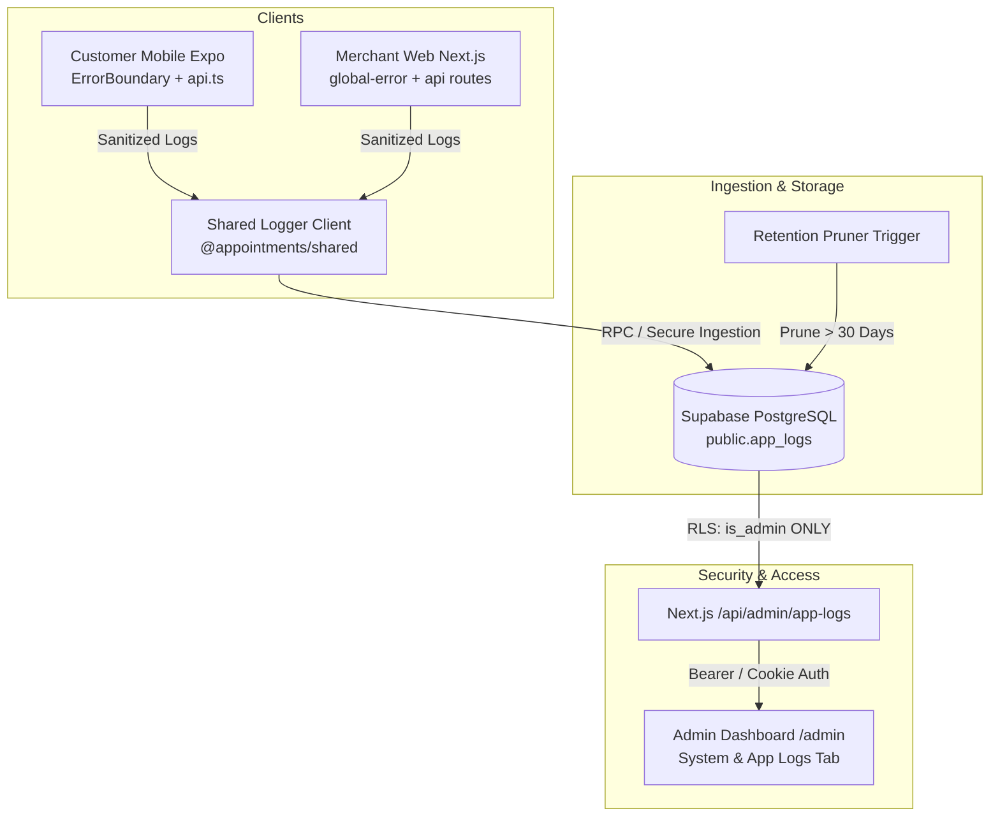

# Plan: Admin-Only Application Logging & Observability System

## 1. Executive Summary & Requirements
- **Goal:** Implement systematic, production-grade error and diagnostic logging across the entire platform (Merchant Web + Customer Mobile + Component-level), accessible exclusively by verified Administrators.
- **Access Control:** Strictly restricted to Admins via Supabase Row-Level Security (`public.is_admin()`) and backend middleware verification (`verifyAdminRequest`).
- **Depth:** Errors, uncaught exceptions, component render crashes, and failed API calls (lightweight & quota-friendly).
- **Data Privacy & Sanitization:** Automated redaction of sensitive PII (bearer tokens, passwords, phone numbers, card data).
- **Retention & Quota:** Automatic 30-day retention pruning to protect PostgreSQL storage limits.
- **Admin UI:** Integrated "System & App Logs" console within the existing Next.js Admin Dashboard (`/admin`).

---

## 2. Architecture & Components

---

## 3. Implementation Breakdown

### Phase 1: Database Migration (Supabase)
- Create migration `20260918000001_create_app_logs_and_admin_security.sql`:
  - Table `public.app_logs`:
    - `id` (uuid, PK)
    - `created_at` (timestamptz, default now())
    - `platform` (text: 'web', 'mobile', 'backend')
    - `level` (text: 'error', 'warn', 'info')
    - `component` (text, e.g. 'ProviderDetailScreen', 'CheckoutModal')
    - `message` (text)
    - `stack_trace` (text)
    - `metadata` (jsonb)
    - `user_id` (uuid references profiles)
    - `session_id` (text)
    - `device_info` (jsonb)
  - Security & RLS:
    - RLS enabled.
    - `SELECT` strictly permitted to `public.is_admin()` users only.
    - `REVOKE UPDATE, DELETE` from public/authenticated users.
    - RPC `public.log_client_event(...)` with `SECURITY DEFINER` for safe ingestion and automated retention cleanup (pruning logs > 30 days).

### Phase 2: Shared Logger Engine (`@appointments/shared`)
- File `packages/shared/src/logger.ts`:
  - `sanitizePayload(data)`: Redacts JWTs, Bearer headers, phone numbers, OTPs, and passwords.
  - `createAppLogger({ platform, getSession, onFlush })`: Batching, debounced async flusher that queues entries and sends them without blocking the UI thread or failing on network drops.
  - Export types in `packages/shared/src/types.ts`.

### Phase 3: Merchant Web Integration
- Create `/api/admin/app-logs/route.ts`:
  - Admin-only endpoint protected by `verifyAdminRequest(request)`.
  - Supports filtering by `platform`, `level`, `component`, `search`, `limit`, and `offset`.
- Add global error boundaries:
  - `apps/merchant-web/src/app/global-error.tsx`: Root Next.js error catcher.
  - Wire logging into `apps/merchant-web/src/lib/sentry.ts` / logger.
- Add "System & App Logs" viewer tab to `apps/merchant-web/src/app/admin/page.tsx`:
  - Adheres strictly to `DESIGN.md` (Tirupati Merchant Command styling, emerald accents, dark zone console styling).
  - Search by message, filter by platform and level.
  - Expandable JSON metadata and stack trace modal/accordion.

### Phase 4: Customer Mobile Integration
- Create `apps/customer-mobile/src/services/logger.ts`:
  - Mobile instance of `createAppLogger` configured for Supabase RPC `log_client_event`.
- Create `apps/customer-mobile/src/components/ErrorBoundary.tsx`:
  - Catches unhandled UI crashes, logs component trace, displays friendly retry screen.
- Wire into `apps/customer-mobile/App.tsx` and API error handlers in `src/services/api.ts`.

### Phase 5: Testing & Verification
- Unit & integration verification script `test-admin-logs.mjs`:
  - Verifies RLS blocks non-admin users from reading `app_logs`.
  - Verifies admin users can read `app_logs`.
  - Verifies PII sanitization.
  - Verifies log ingestion RPC and filter parameters.
- Run project lint & validation tools.
