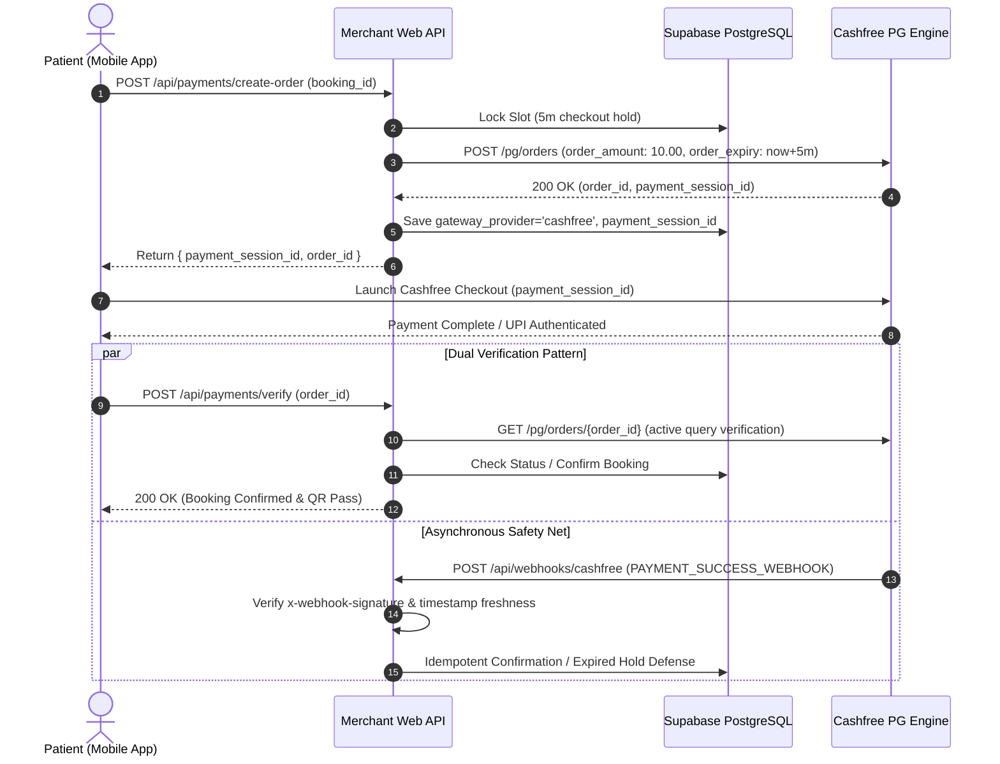

# Technical Design: Migrating Payment Infrastructure from Razorpay to Cashfree

- **Author**: thrinnadhh
- **Status**: Approved
- **Date**: 2026-11-09
- **Branch Target**: `phase-cashfree-migration` (isolated from `fix/production-readiness`)

---

## Overview

The Appointments platform currently binds order generation, checkout validation, webhooks, and refunds to Razorpay. This document specifies the architectural transition from Razorpay to Cashfree Payment Gateway, introducing a unified payment adapter layer that supports both gateways without violating codebase invariants or breaking historical test suites.

---

## The Problem

The platform's payment architecture is coupled to Razorpay APIs, SDKs, and webhook verification algorithms. Introducing Cashfree presents three primary architectural and operational constraints:

1. **Test Suite Invalidation vs. Invariant Rules**: Standing Rule 5 forbids weakening or deleting tests. The codebase contains multiple test suites (`tests/unit/razorpay-refund-integration.test.mjs`, `tests/security/strix-fixes.test.mjs`, `tests/scripts/test-security.mjs`) asserting strict Razorpay behaviors, signature algorithms (HMAC SHA-256 over `order_id|payment_id`), and idempotency headers (`X-Refund-Idempotency`). Directly replacing Razorpay causes these suites to fail immediately.
2. **Webhook Verification Divergence & Concurrency**: Razorpay validates webhooks using `X-Razorpay-Signature` (hex-encoded) over the raw request body. Cashfree verifies webhooks using a timestamped signature format (`x-webhook-timestamp` + `x-webhook-signature`, base64-encoded) over `${timestamp}${rawBody}`. Webhook ingestion must handle out-of-order delivery, replay protection, and race conditions against client-side checkout verification.
3. **Expired Hold Double-Booking Hazards**: Under `docs/hospital/SPEC.md`, checkout slot reservations hold an inventory lock for exactly 5 minutes. If a patient completes payment through the gateway after the hold has expired, unconditional booking confirmation causes illegal overlapping bookings. The system requires atomic hold-expiry evaluation and automated refund triggering.

---

## Goals

1. **Unified Payment Adapter Layer**: Establish a provider-agnostic interface (`PaymentGatewayAdapter`) in `apps/merchant-web/src/lib/payment/` supporting both Cashfree and Razorpay implementations.
2. **Cashfree Gateway Implementation**: Support Cashfree PG Order Creation, Payment Session Generation, Status Verification, and Refund processing via standard `/pg/orders` REST APIs.
3. **Canonical Currency Representation**: Standardize monetary values across the adapter layer in integer paise (`amountInPaise: number`), eliminating currency scaling errors between paise-based gateways (Razorpay) and rupee-based gateways (Cashfree).
4. **Additive Non-Destructive Migrations**: Introduce an additive migration adding `gateway_provider` and `payment_session_id` columns to `bookings`, leaving existing columns (`gateway_order_id`, `gateway_payment_id`) and legacy data intact.
5. **Zero Test Regressions**: Preserve existing Razorpay integration tests through mock interfaces or provider flagging, while creating parallel test suites verifying Cashfree order creation, signature verification, and webhook ingestion.

---

## Non-Goals

1. **Retroactive Migration of Historical Ledger Entries**: Past settled bookings will not be mutated or re-processed in Cashfree.
2. **Multi-Vendor Gateway Splits (Easy-Split)**: Per `docs/hospital/SPEC.md`, patients pay only the platform fee (₹10) or deposit online; consultation fees (₹500) are collected in person at the hospital reception desk (`COLLECTED_AT_DESK`). Online vendor splitting via Cashfree Easy-Split is out of scope.
3. **Multi-Gateway Dynamic Fallback at Runtime**: The system will not dynamically route traffic across gateways on a per-transaction retry basis. Gateway selection is driven by environment configuration (`PAYMENT_GATEWAY_PROVIDER=cashfree|razorpay`).

---

## Open Questions

1. **Deprecation Timeline**: What criteria and timeframe should govern the eventual deprecation of Razorpay once Cashfree has achieved production stability in the Tirupati deployment?

---

## Architecture

### 1. Adapter Abstraction Architecture

To satisfy Standing Rule 5 (never weaken or delete tests) while migrating to Cashfree, the system replaces direct library imports with a gateway adapter interface (`PaymentGatewayAdapter`):

```text
       [apps/merchant-web / apps/customer-mobile]
                          │
                          ▼
             [PaymentGatewayAdapter Interface]
             ├── createOrder(params: CreateGatewayOrderInput) -> GatewayOrderResult
             ├── verifyWebhook(headers, rawBody) -> WebhookVerificationResult
             ├── processRefund(params: ProcessGatewayRefundInput) -> GatewayRefundResult
             └── fetchOrder(orderId: string) -> GatewayOrderDetails
                          │
             ┌────────────┴────────────┐
             ▼                         ▼
   [CashfreeAdapter]          [RazorpayAdapter]
   - Cashfree PG 2025-01-01   - Razorpay API 2024
   - Rupees Scaling (/100)    - Native Paise Units
   - HMAC/Timestamp Verify    - HMAC SHA-256 Verify
   - Max 45-char Order IDs    - Standard UUID Order IDs
```

- **Interface Definition** (`apps/merchant-web/src/lib/payment/types.ts`):
  Defines canonical request and response structures. All monetary inputs are defined as `amountInPaise: number`.
- **Cashfree Adapter** (`apps/merchant-web/src/lib/payment/cashfree-adapter.ts`):
  Translates standard booking parameters into Cashfree's `/pg/orders` payload. Converts `amountInPaise / 100` to format `order_amount`, sanitizes `customer_phone` to 10 numeric digits, and formats `order_id` within Cashfree's 45-character maximum.
- **Razorpay Adapter** (`apps/merchant-web/src/lib/payment/razorpay-adapter.ts`):
  Wraps the existing implementation in `apps/merchant-web/src/lib/razorpay.ts` to keep all historical tests passing in CI without modification.
- **Provider Resolution** (`apps/merchant-web/src/lib/payment/index.ts`):
  Inspects `PAYMENT_GATEWAY_PROVIDER` (defaulting to `cashfree`, falling back to `razorpay` if unconfigured or in legacy test environments).

---

### 2. Platform Booking Fee & Deposit Collection Model

Per `docs/hospital/SPEC.md` lines 10–24 and `docs/decisions.md` (2026-10-26), the platform payment model operates under a split-timing structure:

- **Online Component**: The patient pays strictly the platform fee (₹10) or initial booking deposit online to lock their 20-minute appointment slot.
- **Offline Component**: The doctor's full consultation fee (e.g. ₹500) is paid in person at the hospital reception desk (`consultation_payment_status = 'COLLECTED_AT_DESK'`).
- **Cashfree Order Payload**:
  Order creation invokes standard `/pg/orders` without vendor split arrays:
  ```json
  {
    "order_id": "cf_b100298765432101234567890abcdef12",
    "order_amount": 10.00,
    "order_currency": "INR",
    "customer_details": {
      "customer_id": "cust_8f29c41",
      "customer_phone": "9876543210"
    },
    "order_expiry_time": "2026-11-09T18:05:00+05:30"
  }
  ```
- **Order Expiry Synchronization**: Cashfree's `order_expiry_time` is dynamically set to `now() + 5 minutes`, strictly matching the database slot reservation hold window (`hold_expires_at`).

---

### 3. Additive Database Schema Migration

The existing schema in `packages/shared/src/database.types.ts` already contains generic columns `gateway_order_id` and `gateway_payment_id` on `bookings` and `payments`. A new additive migration (`supabase/migrations/20261109000001_add_payment_gateway_provider.sql`) applies strictly non-destructive additions:

1. **Columns Added to `bookings`**:
   - `gateway_provider`: `VARCHAR(32) NOT NULL DEFAULT 'razorpay'` (supports `'cashfree'`, `'razorpay'`).
   - `payment_session_id`: `TEXT` (stores Cashfree's client checkout session string).
2. **Compound Index**:
   - `CREATE INDEX idx_bookings_gateway_lookup ON bookings (gateway_provider, gateway_order_id);`
3. **No Legacy Column Mutation**: No existing columns are renamed or dropped, and no procedural triggers are created against legacy names.

---

### 4. Webhook Ingestion & Idempotency Lifecycle

1. **Endpoint**: `apps/merchant-web/src/app/api/webhooks/cashfree/route.ts`
2. **Verification Protocol**:
   - Extracts `x-webhook-timestamp` and `x-webhook-signature` from incoming request headers.
   - Enforces replay protection: `Math.abs(Date.now() - Number(timestamp)) < 300000` (5-minute tolerance window).
   - Computes expected HMAC-SHA256 signature using `PAYMENTS_APP_SECRET` over `${timestamp}${rawBody}`, decoded as Base64.
   - Compares signatures using timing-safe buffer comparison (`crypto.timingSafeEqual`).
3. **Fulfillment State Machine & Concurrency Defense**:
   - Executes inside a serializable database transaction with row-level locking:
     ```sql
     SELECT * FROM bookings WHERE gateway_order_id = $1 FOR UPDATE;
     ```
   - **Amount & Currency Validation**: Confirms `data.order.order_amount == booking.platform_fee_amount` and `data.order.order_currency == 'INR'`.
   - **Expired Hold Detection**: If `booking.hold_expires_at < NOW()` and status is not `CONFIRMED`:
     - Does NOT confirm the booking (preventing double-booking collisions).
     - Marks booking status `REFUND_PENDING`.
     - Dispatches an automated refund via `getPaymentGateway().processRefund()`.
   - **Valid Confirmation**:
     - Transitions booking status to `CONFIRMED`.
     - Assigns arrival window (`slot_start - 10m` to `slot_start + 10m`).
     - Links existing customer lifetime 4-digit check-in PIN (`customer_checkin_pins`).
     - Sends SMS booking pass confirmation.
   - Event `PAYMENT_FAILED_WEBHOOK`:
     - Releases reservation hold on slot, marks status `CANCELLED_PAYMENT_FAILED`.
   - Event `REFUND_STATUS_WEBHOOK`:
     - Updates refund ledger in `audit_logs` matching Doctor Emergency / 6-Strike refund rules.

---

### 5. Client Checkout Integration Flow



---

## Risks & Mitigations

| Risk | Impact | Likelihood | Mitigation Strategy |
|---|---|---|---|
| **Gateway Outage during Checkout** | Patients unable to complete online booking payments | Low | The checkout UI detects initialization failures and presents an informative retry state. The slot hold automatically releases after 5 minutes, preventing inventory locking. |
| **Cashfree API Rate Limiting** | Spike in appointment bookings triggers HTTP 429 from Cashfree | Low | Order creation is strictly bounded by hospital slot inventory. Cashfree sandbox and production tiers support >100 QPS, far exceeding hyperlocal booking volume. |
| **Late Payment after Slot Hold Expiry** | Patient pays after minute 5 while slot has been claimed by another user | Medium | Webhook handler checks `hold_expires_at < NOW()`. If expired, it refuses confirmation and initiates an immediate full automated refund. |
| **Webhook Delivery Latency or Dropped Packets** | Patient waits on confirmation screen after completing payment | Medium | Dual-verification checkout pattern: mobile client triggers `/api/payments/verify` on Drop completion for synchronous ticket issuance, treating webhooks as an idempotent safety net. |
| **Currency Scaling Mismatch** | Passing paise to Cashfree causes 100x customer overcharging | High (if unmitigated) | Canonical `amountInPaise: number` enforced at the TypeScript interface level; `CashfreeAdapter` explicitly divides by 100 before building JSON request bodies. |
| **Order ID Truncation Failure** | Cashfree rejects order creation with HTTP 400 if ID > 45 chars | Medium (if unmitigated) | `CashfreeAdapter` computes compact order IDs formatted as `cf_${booking_id.replace(/-/g, '').slice(0, 32)}` (guaranteed <= 36 characters). |

---

## Alternatives Considered

### Alternative A: Direct Replacement of Razorpay

- **Description**: Delete `apps/merchant-web/src/lib/razorpay.ts`, drop Razorpay references, and rewrite existing test files to test only Cashfree.
- **Pros**: Eliminates adapter indirection; avoids maintaining legacy compatibility code.
- **Cons**: Violates Standing Rule 5 ("Never weaken or delete a test"). Breaks existing passing suites (`tests/unit/razorpay-refund-integration.test.mjs`, `tests/security/strix-fixes.test.mjs`) and destroys audit history for past bookings.
- **Reason for Rejection**: Violates codebase invariant Rule 5 by modifying existing test suites and causing CI test regressions during active production readiness certification.

### Alternative B: Online Consultation Prepayment with Cashfree Easy-Split

- **Description**: Charge the full ₹550 consultation and platform fee online, utilizing Cashfree Easy-Split to partition ₹500 to the doctor vendor account and ₹50 to the platform.
- **Pros**: Consolidates financial settlement entirely into digital gateway rails.
- **Cons**: Directly conflicts with `docs/hospital/SPEC.md` and `docs/decisions.md`, which specify offline collection of doctor fees at the clinic desk. Incompatible with 100% refund rules for doctor emergencies and ₹60 penalty caps on strikes 3–5.
- **Reason for Rejection**: Conflicts with established hospital domain invariants and introduces severe financial reconciliation friction during cancellations and no-show strike evaluations.

### Alternative C: Dynamic Active-Active Gateway Routing

- **Description**: Route payments dynamically across both Razorpay and Cashfree at runtime based on health metrics or immediate failure fallback.
- **Pros**: Provides failover redundancy during third-party gateway outages.
- **Cons**: Increases operational overhead by requiring concurrent settlement reconciliation across multiple gateways. Complicates customer support and refund tracing.
- **Reason for Rejection**: Increases operational complexity without proportional benefit for the Tirupati hospital deployment. An environment-level configuration toggle satisfies multi-gateway requirements cleanly.

---

## Detailed Implementation Plan

The implementation is executed layer-by-layer per Standing Rule 2, with strict file enumeration and rationale for every touchpoint.

### 1. Phased Implementation Steps

1. **Phase 1: Database Layer & Shared Types (Additive Schema)**
   - Apply additive migration creating `gateway_provider` and `payment_session_id` columns on `bookings` with compound index `idx_bookings_gateway_lookup` in `supabase/migrations/20261109000001_add_payment_gateway_provider.sql`.
   - Update `packages/shared/src/database.types.ts` to add `gateway_provider: string` and `payment_session_id: string | null` to `bookings` Row, Insert, and Update types.
   - Update `packages/shared/src/types.ts` to add `payment_session_id?: string` to `CreateRazorpayOrderResponse` and shared payment types.
   - Record architectural decision in `docs/decisions.md`.

2. **Phase 2: Payment Abstraction & Cashfree Service**
   - Author gateway types and interface in `apps/merchant-web/src/lib/payment/types.ts` using integer `amountInPaise: number`.
   - Implement `RazorpayAdapter` in `apps/merchant-web/src/lib/payment/razorpay-adapter.ts` wrapping existing logic in `apps/merchant-web/src/lib/razorpay.ts`.
   - Implement Cashfree REST API client in `apps/merchant-web/src/lib/cashfree.ts` and adapter `apps/merchant-web/src/lib/payment/cashfree-adapter.ts` handling paise conversion, phone normalization, and order ID truncation formula `cf_${booking_id.replace(/-/g, '').slice(0, 32)}`.
   - Implement gateway factory `getPaymentGateway()` in `apps/merchant-web/src/lib/payment/index.ts`.

3. **Phase 3: Webhook, Payment Routes, & Asynchronous Recovery**
   - Update `apps/merchant-web/src/middleware.ts` to add `'/api/webhooks/cashfree'` to `PUBLIC_API_ROUTES` to bypass authentication for server-to-server webhook ingestion.
   - Create dedicated Cashfree webhook handler at `apps/merchant-web/src/app/api/webhooks/cashfree/route.ts` with timing-safe HMAC validation (`crypto.timingSafeEqual`), 300s replay tolerance, row-level locking (`SELECT ... FOR UPDATE`), and expired hold auto-refund logic. Return HTTP 200 `{ status: 'OK' }` on success or duplicate delivery; return HTTP 400 on signature failure or replay out of tolerance.
   - Refactor `apps/merchant-web/src/app/api/payments/create-order/route.ts` to delegate to `getPaymentGateway().createOrder()`. When Cashfree is active, emit JSON payload `{ order_id, cf_order_id, payment_session_id, gateway_provider: 'cashfree' }` while setting 5-minute order expiry.
   - Refactor `apps/merchant-web/src/app/api/payments/verify/route.ts` to branch by `gateway_provider`: for Cashfree sessions, query Cashfree REST API via `adapter.fetchOrder(orderId)` to verify `order_status === 'PAID'` and amount equality; preserve HMAC signature verification for Razorpay sessions.
   - Update refund initiation points (`apps/merchant-web/src/app/api/admin/refunds/route.ts`, `apps/merchant-web/src/app/api/bookings/cancel/route.ts`, `apps/merchant-web/src/app/api/doctor/emergency-cancel/route.ts`, `apps/merchant-web/src/app/api/bookings/no-show/route.ts`) to route through adapter `refundOrder()` calls.
   - Ensure the background pgmq refund worker (`supabase/functions/process-refund-queue` per Decision 57) and `recoverStuckRefunds()` in `apps/merchant-web/src/lib/razorpay.ts` resolve the active gateway adapter dynamically using the booking's `gateway_provider` column.

4. **Phase 4: Client, Environment, & Security Configuration**
   - Update Content Security Policy in `apps/merchant-web/next.config.mjs` to authorize Cashfree SDK endpoints (`https://sdk.cashfree.com`, `https://sandbox.cashfree.com`) across `frame-src`, `script-src`, and `connect-src` directives.
   - Update `apps/merchant-web/src/env.mjs` to conditionally enforce production credentials based on `PAYMENT_GATEWAY_PROVIDER` and register `CASHFREE_` prefix in `APP_KEY_PREFIXES`.
   - Update `apps/customer-mobile/src/services/api.ts` to return `payment_session_id` from order creation and provide Cashfree verification service calls.
   - Update checkout completion handler in `apps/customer-mobile/src/screens/CheckoutModal.tsx` to handle `payment_session_id` via Cashfree Drop SDK while preserving existing `loadRazorpayScript()` SHA-384 integrity and `crossOrigin` attributes.
   - Standardize environment variables in `apps/merchant-web/.env.example` (`PAYMENT_GATEWAY_PROVIDER`, `CASHFREE_APP_ID`, `CASHFREE_SECRET_KEY`, `CASHFREE_ENV`) and `apps/customer-mobile/.env.example` (`EXPO_PUBLIC_CASHFREE_ENV`).

5. **Phase 5: Test Suite Verification & Full Gate Execution**
   - Author unit test suite `tests/unit/cashfree-adapter.test.mjs` verifying Cashfree request payload generation, paise-to-rupee integer conversion (1000 paise -> ₹10.00), order ID bounds (`<= 45` chars using `cf_${booking_id.replace(/-/g, '').slice(0, 32)}`), and timing-safe signature verification.
   - Author unit test suite `tests/unit/cashfree-webhook-idempotency.test.mjs` using mock database client verifying webhook replay tolerance (rejecting timestamps drift > 300s with HTTP 400), row-locking state transitions, duplicate delivery idempotency (HTTP 200 without duplicate PIN/SMS generation), and expired hold auto-refund triggering (`hold_expires_at < now()`).
   - Author unit test suite `tests/unit/cashfree-refund-integration.test.mjs` verifying Cashfree refund payload formatting, status mapping, and stuck refund recovery.
   - Update `tests/scripts/test-security.mjs` to add assertions verifying Cashfree CSP whitelist in `frame-src`, `script-src`, and `connect-src`, and timing-safe webhook comparison.
   - Execute full gate serially: `supabase db reset`, execute all test suites serially, run typecheck (`pnpm run typecheck`) and build across both packages (`pnpm run build`), ensuring 100% test pass without regressions.

---

### 2. File Enumeration & Rationale

| Action | File Path | Rationale |
|---|---|---|
| **CREATE** | `supabase/migrations/20261109000001_add_payment_gateway_provider.sql` | Adds `gateway_provider` and `payment_session_id` columns with compound index `idx_bookings_gateway_lookup`. |
| **UPDATE** | `packages/shared/src/database.types.ts` | Updates `bookings` Row, Insert, and Update types with `gateway_provider: string` and `payment_session_id: string \| null`. |
| **UPDATE** | `packages/shared/src/types.ts` | Adds `payment_session_id?: string` to `CreateRazorpayOrderResponse` and shared payment types. |
| **UPDATE** | `docs/decisions.md` | Documents the decision and date for adopting Cashfree and implementing gateway adapter architecture per Standing Rule 7. |
| **CREATE** | `apps/merchant-web/src/lib/payment/types.ts` | Defines `PaymentGatewayAdapter` interface and request/response types with integer `amountInPaise`. |
| **CREATE** | `apps/merchant-web/src/lib/payment/razorpay-adapter.ts` | Wraps existing `razorpay.ts` to satisfy the adapter interface. |
| **CREATE** | `apps/merchant-web/src/lib/cashfree.ts` | Cashfree REST API client for Order creation, session generation, status query, and refunds. |
| **CREATE** | `apps/merchant-web/src/lib/payment/cashfree-adapter.ts` | Adapter mapping `PaymentGatewayAdapter` calls to `cashfree.ts`, handling paise conversion, phone normalization, and order ID truncation via `cf_${booking_id.replace(/-/g, '').slice(0, 32)}`. |
| **CREATE** | `apps/merchant-web/src/lib/payment/index.ts` | Factory resolving active adapter instance via `PAYMENT_GATEWAY_PROVIDER`. |
| **UPDATE** | `apps/merchant-web/src/middleware.ts` | Adds `'/api/webhooks/cashfree'` to `PUBLIC_API_ROUTES` to bypass authentication for server-to-server webhook ingestion. |
| **UPDATE** | `apps/merchant-web/src/app/api/payments/create-order/route.ts` | Refactors order creation to use `getPaymentGateway().createOrder()`, writing `payment_session_id` and setting 5-minute order expiry. |
| **UPDATE** | `apps/merchant-web/src/app/api/payments/verify/route.ts` | Verifies Cashfree payment status via adapter API query (`order_status === 'PAID'`) alongside existing Razorpay HMAC signature verification. |
| **CREATE** | `apps/merchant-web/src/app/api/webhooks/cashfree/route.ts` | Dedicated webhook ingestion endpoint with replay tolerance check (300s), timing-safe HMAC validation, row-level locks, and expired hold auto-refund logic. |
| **UPDATE** | `apps/merchant-web/src/app/api/admin/refunds/route.ts` | Replaces direct Razorpay refund calls with adapter `refundOrder()` calls and aligns pgmq background worker resolution. |
| **UPDATE** | `apps/merchant-web/src/app/api/bookings/cancel/route.ts` | Routes customer-initiated free cancellations through gateway adapter refund method. |
| **UPDATE** | `apps/merchant-web/src/app/api/doctor/emergency-cancel/route.ts` | Routes doctor emergency cancellations through gateway adapter refund method. |
| **UPDATE** | `apps/merchant-web/src/app/api/bookings/no-show/route.ts` | Routes strike courtesy refunds through gateway adapter refund method. |
| **UPDATE** | `apps/merchant-web/next.config.mjs` | Extends CSP `frame-src`, `connect-src`, and `script-src` policies to allow Cashfree sandbox and production domains (`https://sdk.cashfree.com`, `https://sandbox.cashfree.com`). |
| **UPDATE** | `apps/merchant-web/src/env.mjs` | Conditionally enforces production credentials based on `PAYMENT_GATEWAY_PROVIDER` and registers `CASHFREE_` prefix in `APP_KEY_PREFIXES`. |
| **UPDATE** | `apps/customer-mobile/src/services/api.ts` | Updates mobile client service functions to return `payment_session_id` and handle Cashfree verification. |
| **UPDATE** | `apps/customer-mobile/src/screens/CheckoutModal.tsx` | Updates payment invocation to pass `payment_session_id` to Cashfree Drop component while preserving `loadRazorpayScript()` SHA-384 integrity and `crossOrigin` attributes. |
| **UPDATE** | `apps/merchant-web/.env.example` | Adds `PAYMENT_GATEWAY_PROVIDER`, `CASHFREE_APP_ID`, `CASHFREE_SECRET_KEY`, and `CASHFREE_ENV` variable specifications. |
| **UPDATE** | `apps/customer-mobile/.env.example` | Adds `EXPO_PUBLIC_CASHFREE_ENV` environment variable for mobile client. |
| **CREATE** | `tests/unit/cashfree-adapter.test.mjs` | Unit test suite validating Cashfree request payload generation, paise conversion, order ID bounds, and signature verification. |
| **CREATE** | `tests/unit/cashfree-webhook-idempotency.test.mjs` | Unit test suite verifying replay rejection, timing-safe HMAC verification, row locking, and expired hold auto-refund triggering using mock database. |
| **CREATE** | `tests/unit/cashfree-refund-integration.test.mjs` | Unit test suite verifying Cashfree refund payload formatting, status mapping, and stuck refund recovery. |
| **UPDATE** | `tests/scripts/test-security.mjs` | Adds security audit assertions verifying Cashfree CSP whitelist (`frame-src`, `connect-src`, `script-src`) and timing-safe webhook comparison. |
